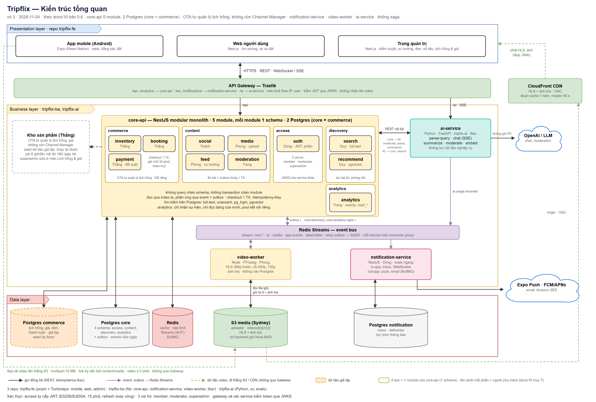

# Tripflix architecture guide — Frontend

AI agents: read this file and [RULES.md](RULES.md) before changing code.

## Canonical system architecture

> The PNG preview above is still v4.5 (it shows a separate `commerce` database). The editable `.drawio` file is v4.6 and is canonical: `commerce` is a schema in the `core` database. Re-export the PNG from the `.drawio` file.

The editable diagram is the canonical system view (v4.6, 2026-11-04). The presentation layer separates Front Office (`apps/mobile`, `apps/web`) is the guest/member area for discovery, posting, and booking. Back Office (`apps/admin`) is the internal Admin Console for `moderator` and `superadmin` operations and moderation. Both surfaces use the same Traefik API Gateway and `core-api`; admin permissions are enforced by backend role guards. Video uploads go directly to S3, then playback uses CloudFront. Do not send video through the API Gateway.

The [editable diagram](docs/architecture/06-kien-truc-tong-quan.drawio) is the source for the preview. Supporting decisions and repo structure are in [architecture doc 10](docs/architecture/10-de-xuat-kien-truc-va-repo.md) and [architecture doc 11](docs/architecture/11-de-xuat-cau-truc-repo.md). If a supporting document conflicts with the v4.6 diagram, flag the conflict and follow the diagram until the architecture is reconciled.

## Frontend boundaries

- Keep Android, user web, and admin in their respective apps; put shared code in `packages/`.
- Front Office (`mobile`, `web`) is for guests and members; Back Office (`admin`) is for `moderator` and `superadmin`. Do not treat client-side route hiding as authorization.
- Call backend and AI APIs through `packages/api-client`. Generate contracts from the sibling `tripflix-be` and `tripflix-ai` repos.
- Put user-facing Vietnamese text in `packages/i18n`; use design tokens from `packages/tokens`.
- Keep platform-specific code inside the app that owns that platform. `packages/app-core` stays independent of React Native and React DOM.
- Organize app code by feature and follow the ownership rules in `RULES.md`.
