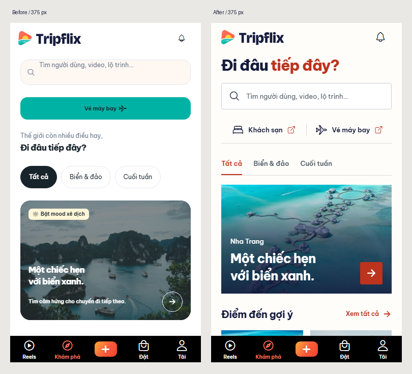

# Khám phá mobile · SCRUM-166

Thiết kế tiếp nối onboarding: Be Vietnam Pro, navy/coral, nền sáng ấm, ảnh góc vuông và CTA góc 3–4px. Không thêm dependency.



## Thay đổi

- Đưa tiêu đề nhu cầu lên đầu; tìm nội dung và các dịch vụ có thứ bậc riêng.
- Khách sạn và vé máy bay nằm cạnh nhau, không còn nút vé máy bay tràn cả hàng.
- Bộ lọc chuyển sang tab có gạch chân, trạng thái selected cho accessibility.
- Hero và ảnh điểm đến bỏ góc tròn lớn; tên điểm đến và hành động đọc được ở viewport đầu 375×667.
- Gợi ý nơi ở dùng hàng ảnh/tên/giá, giữ lý do gợi ý và các lối mở chi tiết/tìm thêm deal.
- Có skeleton theo bố cục hàng, empty/error/retry và fallback cho ảnh thiếu/hỏng. API trả điểm đến không có khách sạn cũng hiện empty state.
- Nhãn cụm điểm đến tĩnh là “Điểm đến gợi ý”, không khẳng định đã cá nhân hoá theo khảo sát.

## Kiểm chứng

Ngày 17/11/2026: mobile typecheck, lint, boundary check và git diff check pass. Lint còn các cảnh báo Reels có sẵn, không phát sinh cảnh báo trong phần Khám phá.

[qa-results.json](qa-results.json) ghi 8 nhóm kiểm thử Playwright pass, không có pageErrors:

- Layout 320/375/390/430px, hero và dịch vụ ở viewport đầu; tên dài, giá lớn, ảnh thiếu và không tràn ngang.
- Đổi chủ đề, mở điểm đến/khách sạn/chuyến bay/tìm nội dung/thông báo và quay lại.
- Empty, HTTP 503 và retry; loading; mảng khách sạn rỗng và ảnh trả 404.

Ảnh before lấy từ nhánh onboarding PR #174; after chụp từ SCRUM-166. Home API dùng fixture công khai trong `tools/verify-mobile-explore.cjs` để kiểm tra presentation và điều hướng ổn định. Fixture không nằm trong app và không thay đổi dữ liệu backend. Không dùng kết quả này để nghiệm thu ranking hoặc giá/chỗ thật.

```powershell
$env:PLAYWRIGHT_PACKAGE='C:/path/to/node_modules/playwright'
$env:MOBILE_PREVIEW_URL='http://localhost:8082'
node tools/verify-mobile-explore.cjs
```

## Phạm vi còn lại

Chưa kiểm thử iOS/Android thật, font hệ thống lớn và screen reader native. API home, limit=3, query key và tham số điều hướng giữ nguyên; chưa nối sở thích onboarding vào ranking. Hệ UI toàn app (SCRUM-137), tìm kiếm (SCRUM-149) và nguồn cá nhân hoá (SCRUM-157/163/164) còn scope riêng.

Nhánh `feat/SCRUM-166-mobile-explore` tiếp nối nhánh onboarding. PR nền: [#174](https://github.com/Sukemcute/tripflix-fe/pull/174), vào develop, CI pass.
