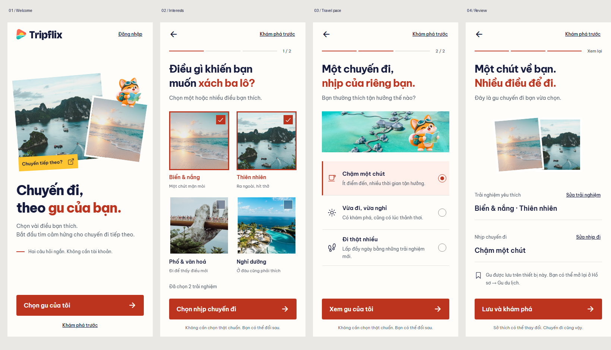

# Mobile onboarding · SCRUM-159

Luồng mới: trang chào → chọn trải nghiệm → chọn nhịp đi → xem lại/sửa → lưu và khám phá. Khách có thể bỏ qua hoặc đăng nhập sau; Hồ sơ có lối mở lại Gu du lịch.



## Kiểm chứng

- Chạy lại trên nhánh đã cập nhật từ develop ngày 17/11/2026.
- Mobile TypeScript: pass sau khi Metro tạo lại route types cho các route mới từ develop.
- Mobile lint: pass; còn các cảnh báo Reels có sẵn, không có cảnh báo trong phần onboarding.
- Playwright: 9 nhóm kiểm thử pass; kết quả máy đọc được trong [qa-results.json](qa-results.json).
- Các cỡ preview: 320×568, 375×667, 390×844, 430×932.
- Bao gồm back/reload bản nháp, lưu/skip và không hỏi lại, sửa từ Hồ sơ không kích hoạt first-run, deep link và lỗi lưu/retry.

Chạy lại bằng runtime Playwright sẵn có, không thêm dependency vào app:

```powershell
$env:PLAYWRIGHT_PACKAGE='C:/path/to/node_modules/playwright'
$env:MOBILE_PREVIEW_URL='http://localhost:8082'
node tools/verify-mobile-onboarding.cjs
```

Gu hiện chỉ lưu trên thiết bị. Chưa nối API/taxonomy/ranking, hợp nhất tài khoản hoặc đồng bộ đa thiết bị. Chưa kiểm chứng trên iOS/Android thật, font hệ thống lớn và screen reader native.

Task: [SCRUM-159](https://tripflix.atlassian.net/browse/SCRUM-159). Bàn giao contract tích hợp cho Duy: [SCRUM-171](https://tripflix.atlassian.net/browse/SCRUM-171).
