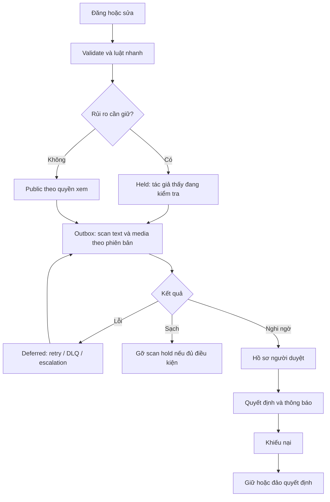

# Báo cáo kiểm duyệt bài đăng và bình luận: Tripflix so với TikTok

Ngày nghiên cứu: **12/11/2026**. Phạm vi: bài đăng, bình luận, report, xử lý của moderator, thông báo, khiếu nại và kiểm duyệt media.

Đây là bản Markdown của báo cáo đã trình bày trong chat, bổ sung liên kết sang [kế hoạch FE/BE](02-ke-hoach-trien-khai-fe-be.md). Tài liệu mô tả hiện trạng và đề xuất; chưa triển khai thay đổi nghiệp vụ.

## 1. Kết luận

Tripflix đã có nền tảng sàng lọc và công cụ moderator. Phần cần hoàn thiện nhất là **vòng đời sau phát hiện**: lưu bằng chứng theo phiên bản, xử lý lỗi AI, thông báo lý do, khiếu nại, khôi phục và cập nhật nhất quán các đường đọc.

Thứ tự đề xuất:

1. **P0:** chống report phá; theo dõi scan và retry; khôi phục bình luận bị nền tảng gỡ; thông báo và khiếu nại.
2. **P1:** giữ nội dung rủi ro trước public; bộ lọc bình luận của chủ bài; mở rộng kiểm tra ảnh/video; SLA và thống kê backend.
3. **P2:** lịch sử vi phạm, hạn chế tài khoản có thời hạn và điều kiện được đề xuất.

## 2. Phương pháp và giới hạn

- Đối chiếu tĩnh source chính: `tripflix-be` tại HEAD `c195944`, `tripflix-fe` tại `edb0e02`, `tripflix-ai` tại `195a628` trong lượt nghiên cứu trước.
- Workspace có checkout `moderation-pr` riêng; không mặc định các checkout và production giống nhau.
- Nguồn TikTok là Help Center và Newsroom chính thức. Không có quyền truy cập hệ thống nội bộ TikTok.
- “Chưa thấy” nghĩa là chưa có trong phạm vi module/luồng đã đọc và tìm kiếm, không khẳng định mọi hệ thống bên ngoài đều thiếu.
- Chưa chạy lại test, đo tải, kiểm tra cấu hình production hoặc chứng minh đã có hành vi tấn công.
- Các ngưỡng, API, SLA và lịch triển khai phía dưới là **đề xuất cho Tripflix**, không phải thông số của TikTok.

## 3. TikTok công khai cách làm như thế nào?

### 3.1. Kiểm duyệt nền tảng

TikTok kết hợp công nghệ tự động và người duyệt. Nội dung có thể được review khi upload, khi trở nên phổ biến hoặc khi bị report. Có các kết quả như gỡ nội dung hoặc không đủ điều kiện xuất hiện trên For You; tác giả được thông báo lý do và có quyền khiếu nại. [T1]

TikTok mô tả warning/strike theo nhóm chính sách hoặc tính năng; strike hết hạn sau 90 ngày. Khiếu nại được chấp nhận có thể khôi phục nội dung/tài khoản và bỏ strike, trừ trường hợp người dùng đã tự xóa. Không nên suy ra ngưỡng khóa tài khoản cụ thể từ tài liệu này. [T1]

### 3.2. Công cụ của chủ bài

TikTok cho phép bật/tắt bình luận, chọn nhóm người được bình luận, lọc từ khóa, spam và bình luận không phù hợp. Creator Care Mode hỗ trợ lọc thêm; chủ bài có thể duyệt hoặc xóa bình luận bị lọc. Chế độ lọc toàn bộ bình luận chưa có cho mọi người dùng. [T2]

**Áp dụng:** cần phân biệt quyết định của nền tảng với bộ lọc của chủ bài. Chủ bài chấp nhận một bình luận không có nghĩa được vượt qua lệnh chặn của nền tảng.

### 3.3. Tự động hóa và vận hành

Trong báo cáo EU kỳ 01–06/2026, TikTok tự công bố 94,1% nội dung vi phạm được hệ thống tự động xử lý mà không cần human review. Con số này **không phải độ chính xác của AI**, không đại diện riêng cho Việt Nam và không nên dùng làm KPI cần sao chép cho Tripflix. [T3]

TikTok cũng mô tả công cụ phát hiện và xếp ưu tiên nội dung để người duyệt xử lý các trường hợp khẩn cấp trước. Nguồn này cung cấp định hướng tổng quát, không công khai toàn bộ kiến trúc hiện tại. [T4]

## 4. Hiện trạng Tripflix

### 4.1. Những gì đã có

- Event sau đăng/sửa bài và bình luận kích hoạt `ScreenContentUseCase`.
- Core kết hợp luật, kết quả AI và số report để đánh giá severity.
- `moderation_cases` có trạng thái `pending/resolved`, nguồn tín hiệu, flags và thông tin xử lý.
- Report xác thực người gửi và dedupe theo target/reporter.
- Moderator có `hide`, `restore`, `remove`, `dismiss`; quyết định có audit và outbox.
- Có kiểm tra phiên bản giữa đọc snapshot và ghi verdict, cùng bảo vệ quyết định staff trước event cũ.
- Bình luận có cascade ẩn/khôi phục theo parent, tránh hiện lại reply bị xử lý độc lập.
- Admin đã có queue, chi tiết, lịch sử và thao tác hàng loạt. [E1–E8]

### 4.2. Các khoảng trống quan trọng

| Mức | Khoảng trống | Bằng chứng và tác động |
| --- | --- | --- |
| P0 | Report có thể tự làm mất nội dung | Mặc định threshold 3 report trong 24 giờ; `evaluateSeverity` có điều kiện tự ẩn theo số lượng. Dedupe một tài khoản không ngăn được nhiều tài khoản phối hợp. [E1, E2] |
| P0 | AI lỗi chưa có vòng kiểm tra bù riêng | Client trả `null`; pha ghi vẫn nhận event đã xử lý. Nếu không có tín hiệu khác, có thể không tạo case. Không nên hiểu đây là scan sạch. [E1, E3] |
| P0 | Bình luận bị nền tảng gỡ chưa restore được | Remove đặt `deletedAt`; guard chặn target đã deleted hoặc comment `removed`. Cần phân biệt nền tảng gỡ với tác giả tự xóa. [E4, E6] |
| P0 | Chưa hoàn chỉnh thông báo và appeal | Có event moderation khi có `caseId`; chưa thấy handler thông báo tương ứng trong router đã đọc, cũng chưa thấy mô hình appeal ở module moderation. [E4, E5, E7] |
| P1 | Media coverage hạn chế | Luồng hiện gửi text và poster cover `w540` khi có; không đại diện mọi ảnh, khung hình, chữ trong video hoặc audio. [E1] |
| P1 | Thiếu lớp lọc của chủ bài | Chưa thấy comment settings và filtered queue của chủ bài trong các luồng FE/BE đã kiểm tra. |
| P1 | Thống kê UI chưa đại diện toàn tập | Một số số đếm được tính từ trang queue/log tối đa 100 dòng; cần aggregate backend trước dùng làm KPI vận hành. [E8] |
| P2 | Chưa thấy ledger vi phạm và eligibility riêng | Cần nối quyết định, appeal và lịch sử tài khoản trước khi tự động xử phạt. |

Lưu ý: `dismiss` đóng hồ sơ và giữ nguyên trạng thái nội dung. Với nội dung đã tự ẩn, cần `restore` nếu muốn cho hiện lại; FE phải giải thích rõ hai thao tác.

## 5. Nguyên tắc thiết kế đề xuất

1. **Report là tín hiệu điều tra.** Không dùng số report đơn lẻ để kết luận vi phạm hoặc cộng strike.
2. **AI lỗi khác AI cho qua.** Mọi phiên bản đủ điều kiện cần scan outcome rõ ràng và lịch xử lý bù.
3. **Quyết định gắn phiên bản.** Lưu `decisionId`, phiên bản/hash nội dung, chính sách và bằng chứng tại thời điểm quyết định.
4. **Tách các trạng thái.** Trạng thái nội dung, tiến độ scan/case và appeal có vòng đời riêng.
5. **Phân biệt xóa và gỡ.** Không khôi phục nội dung người dùng tự xóa khi đảo quyết định của nền tảng.
6. **Nền tảng có quyền chặn cuối cùng.** Chủ bài chỉ gỡ bộ lọc của mình; không được bỏ platform hold/removal.
7. **Bảo vệ ở API nguồn.** Feed/search/cache/inbox không được là lớp bảo vệ quyền xem duy nhất.
8. **Giữ ngữ cảnh tiếng Việt.** Chê dịch vụ, giá đắt, link/số điện thoại và đặt cọc hợp lệ không tự chứng minh spam, harassment hoặc lừa đảo.
9. **Ngưỡng AI phải đánh giá riêng.** Score của provider không mặc định là xác suất đã hiệu chuẩn.
10. **Có đường đảo quyết định.** Restore phải cập nhật counter, các projection và notification, đồng thời tôn trọng mọi lý do giữ ẩn khác.

## 6. Luồng nghiệp vụ đích

### 6.1. Bài đăng

Đây là luồng đề xuất của Tripflix; không khẳng định TikTok bắt mọi bài chờ duyệt trước public. AI và I/O media phải chạy ngoài transaction ghi dữ liệu.

### 6.2. Bình luận

Kiểm tra quyền bình luận → kiểm tra nền tảng → áp bộ lọc chủ bài → visible hoặc held theo từng lý do → cập nhật counter và phát notification khi đủ điều kiện công khai.

Khi chủ bài approve, chỉ bỏ creator hold. Khi nền tảng restore, vẫn phải xét creator hold, trạng thái parent và việc tác giả có tự xóa hay không.

### 6.3. Báo cáo

Nhận report → xác thực/dedupe/rate limit → gắn phiên bản và hồ sơ → ưu tiên điều tra → quyết định theo bằng chứng → cung cấp kết quả phù hợp cho reporter. Không tiết lộ danh tính reporter cho tác giả.

### 6.4. Khiếu nại

Tác giả mở chi tiết quyết định qua endpoint dành cho mình → gửi appeal theo `decisionId` → người có quyền xem snapshot, chính sách và trạng thái hiện tại → upheld hoặc overturned → đồng bộ trạng thái và thông báo.

Reviewer không tự xét quyết định của chính mình. Đội thiếu người cần chuyển superadmin hoặc hàng chờ riêng; không tự động bỏ kiểm tra này.

## 7. Lộ trình và đo lường

Chi tiết FE, BE, API, migration và kịch bản kiểm thử nằm trong [kế hoạch triển khai](02-ke-hoach-trien-khai-fe-be.md).

Các chỉ số cần đo: tỷ lệ hoàn tất scan theo phiên bản và modality; thời gian xử lý; lượng tiếp cận trước khi chặn; backlog age; lỗi/retry/DLQ; độ chính xác auto-hide; recall theo nhóm rủi ro; tỷ lệ đảo quyết định qua appeal và audit ngẫu nhiên. **Appeal overturn rate không thay thế false-positive rate.**

Không đặt mục tiêu “tự động hóa càng nhiều càng tốt”. Đầu tiên cần quyết định đúng, giải thích được và đảo được khi sai.

## 8. Nguồn tham khảo

### Nguồn TikTok

- **T1:** [Content violations and bans](https://support.tiktok.com/en/safety-hc/account-and-user-safety/content-violations-and-bans).
- **T2:** [Manage comments](https://support.tiktok.com/en/account-and-privacy/account-privacy-settings/manage-comments).
- **T3:** [Seventh DSA Transparency Report — 31/08/2026](https://newsroom.tiktok.com/digital-services-act-our-seventh-transparency-report-on-content-moderation-in-europe?lang=en-150).
- **T4:** [Virtual Transparency & Accountability Center](https://newsroom.tiktok.com/an-update-on-our-virtual-transparency-and-accountability-center-experience?amp=&lang=en).

### Bằng chứng source Tripflix

Đường dẫn tương đối từ file báo cáo để có thể đọc cùng workspace:

- **E1:** [Screening/report/decision use cases](../../tripflix/tripflix-be/apps/core-api/src/modules/content/moderation/application/moderation.use-cases.ts).
- **E2:** [Severity policy](../../tripflix/tripflix-be/apps/core-api/src/modules/content/moderation/domain/severity.ts).
- **E3:** [AI client](../../tripflix/tripflix-be/apps/core-api/src/modules/content/moderation/infra/ai-moderation.client.ts).
- **E4:** [Change visibility, restore và cascade](../../tripflix/tripflix-be/apps/core-api/src/modules/content/moderation/application/change-visibility.use-case.ts).
- **E5:** [Moderation schema](../../tripflix/tripflix-be/apps/core-api/src/modules/content/db/schema/moderation.ts).
- **E6:** [Comments schema](../../tripflix/tripflix-be/apps/core-api/src/modules/content/db/schema/comments.ts).
- **E7:** [Notification router](../../tripflix/tripflix-be/apps/notification-service/src/consumers/event-router.ts).
- **E8:** [Admin moderation workspace](../../apps/admin/src/features/moderation/moderation-workspace.tsx).
